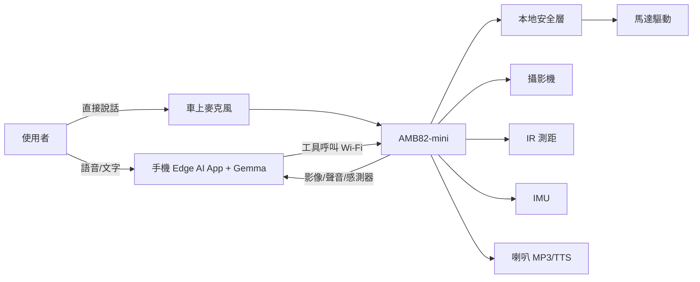
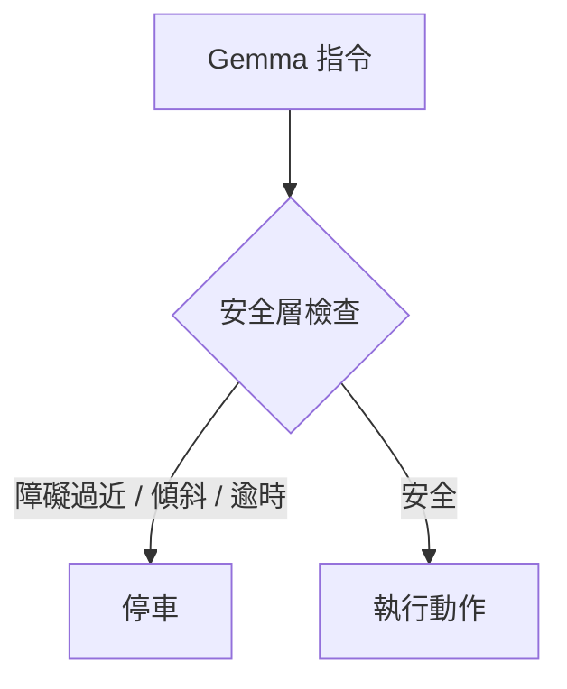

# LabPatrol：實驗室巡檢 RoboCar

> 使用 **AMB82-mini** 作為機器人控制器，搭配 Google Edge AI + Gemma4-E2B 的雙輪代理機器人。

<!-- 請用下方提示詞生成圖片，存成 images/product.png 後上傳 -->

## 功能
- 用語音或文字下達巡檢任務（例：檢查 3 號桌電源供應器是否亮燈）
- 車載攝影機取像，由 Gemma 描述並判斷
- IR 與 IMU 本地安全層：障礙、傾斜、斷線自動停車
- 音效先行 + TTS 回覆，降低等待感
- 任務日誌（影像、感測器、判斷結果）

## 系統架構

## 安全流程

## 硬體
AMB82-mini、雙輪底盤與馬達驅動、IR 測距、IMU、喇叭、SD 卡、電池、手機或平板

## 使用方式
1. 燒錄 AMB82-mini 韌體並連上 Wi-Fi
2. 手機開啟 App，輸入車子 IP
3. 以文字或語音下達任務

## AI 成品圖提示詞
> A cute small two-wheel robot car with a front camera and small speaker, patrolling an electronics lab with oscilloscopes and power supplies on benches, friendly design, soft lighting, product render, clean background.

## 文件
詳細規劃請見 [PROPOSAL.md](PROPOSAL.md)
